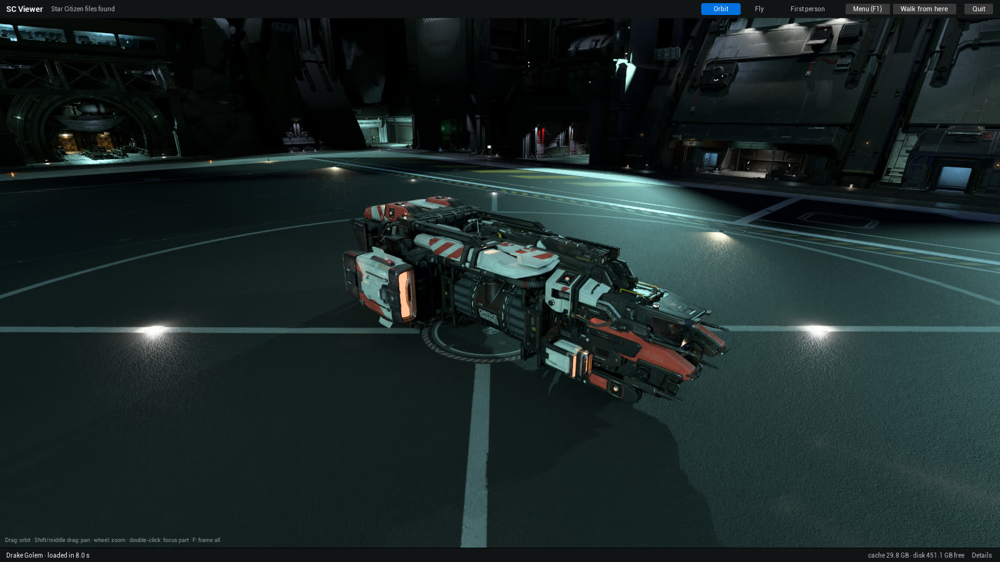

# UnrealCitizen

## SC Viewer — any ship, any hangar, any paint

**SC Viewer** shows any ship from your own Star Citizen installation, in any of the game's hangars, in any of its
paints. You can recolour any paint and walk around and inside the ship. It is free, it runs on Windows, and it reads
the game files already on your PC.



**[⬇ Download for Windows](https://github.com/baadc0de/UnrealCitizen/releases/latest)** (the `SCViewer-…-win64.zip`
under Assets) · **[User guide](docs/viewer/USER_GUIDE.md)** · **[Report a problem](https://github.com/baadc0de/UnrealCitizen/issues)**

1. Download the zip and unzip it into a folder such as `C:\Games` (not `Program Files`).
2. Double-click `SCViewer\SCViewer.exe`. It finds Star Citizen by itself, or asks where `Data.p4k` is.
3. Pick a hangar, a ship and a paint in the menu (F1). To change a paint's colours beside the ship, click **SHOW SHIP**.

**You need:** Windows 10 or 11 (64-bit); Star Citizen installed; a DirectX 12 graphics card with Shader Model 6.6
(GeForce GTX 1060 / Radeon RX 5000 / Intel Arc or newer); 16 GB RAM; 12 GB of free disk to start (the cache can grow to 40 GB). Hardware ray tracing (GeForce
RTX, Radeon RX 6000 or newer) gives the best lighting; without it the viewer uses simpler lighting
("Basic lighting"). The [user guide](docs/viewer/USER_GUIDE.md#1-requirements) has the details.

SC Viewer is a fan project, not made or endorsed by Cloud Imperium Games. It only reads the game's files; it never
changes the game or touches your account.

## For developers

> Formerly `SC_UE_ModelViewer`. The repository is being split into the StarBreaker core (`vendor/StarBreaker`,
> `crates/`), the viewer (`viewer/`, with the shared plugin `plugins/SCBridge`) and the UnrealCitizen game
> (`game/`); see [WP-O1](docs/work-packages/WP-O1-unrealcitizen-split.md). The rest of this page describes how the
> viewer is built.

An **Unreal Engine 5.9 viewer for Star Citizen game data**. Point it at a `Data.p4k` and it lists the entities inside
and exports the chosen one in memory through Rust. It then builds real UE objects at run time and shows them under Nanite, Lumen
and MegaLights:
- Nanite meshes with Lumen cards, distance fields and ray-tracing geometry;
- skeletal meshes and animation sequences;
- Substrate materials and lights.

You can then explore ships in first person or move cargo with drones. The app runs as a game-mode application (the editor binary
launched with `-game`); the Unreal Editor is a development host, not the deliverable.

The archive formats are read by the Rust crates of [StarBreaker](https://github.com/diogotr7/StarBreaker) (MIT),
vendored as a git submodule at `vendor/StarBreaker` (our patches live on `scviewer/<topic>` branches of the
[public fork](https://github.com/baadc0de/StarBreaker) and go upstream from there).

### What it does

- **Picker (F1).** An environment from the game's player hangars, a vehicle from one row per ship a player would
  recognise, and its paint; the lists come from game data (WP-O1-3). The model comes through the FFI library
  (`scbridge-ffi`) as a decomposed package (geometry, material semantics, lights, hierarchy, clips). The runtime
  importer builds it step by step within a frame budget. Orbit and free-fly cameras, focus and framing.
- **Game-derived appearance.**
  - Materials follow the game's shader families: HardSurface, Layered, Illum, glass, decals, stencils, paints from
    the tint system, dirt.
  - Lights use the game's photometry and room confinement.
  - Exposure and the display curve are taken from the installed game's renderer
    (`StarEngineRender.json`, checked by `scripts/verify_star_engine_render.py`).
  - Nothing is tuned per asset (plan D11). The look target is a modern path-traced sci-fi look with GI on (D15).
- **Environments.** Game hangars and other object containers (`.socpak`) load as levels around the ship, either live
  from the archive or as cooked levels (WP-C1). Ships come out of the hangar elevator, and their doors open from
  their pads and on approach.
- **Animations.** A clip catalogue (`chrparams`, DBA, Mannequin) with play, snap, loop and compose on the vehicle
  rig: landing gear, canopies, wings, doors.
- **First person.**
  - Walk ships with collision against the game's own colliders.
  - Use doors and ramps through their animation fragments; teleport, torch, noclip.
  - The armed player body is exported from a game loadout: blend-space locomotion, weapons that fire, aim down
    sights, third person.
- **Cargo by drones.** Cargo grids, boxes and tractor-beam values come from the package and DataCore:
  - Drones lift boxes physically along the grid normal and fly them on swept, obstacle-aware routes. They work in
    teams sized by beam force and volume (WP-K1).
  - Transfers are ordered from an in-game mobiGlas Cargo app.
  - Failed loads fall back to the nearest free slot or to loose cargo in named beacons (WP-K2).
  - Scenarios run in hangars or in open space among asteroids at zero g (WP-K3). Several vehicle instances and
    owners can share a level.
- **Scripted and exploratory testing.** `-SCScript` routes with `-SCShotDir` screenshots. A localhost RPC server
  (`-SCRpc`) drives the running app: load, spawn, cargo, camera, screenshots, MP4 recording. An NDJSON state log
  reports positions, forces, idle and settled events, and anomalies. `explore.ps1` makes seeded random scene changes
  and checks stability after each (WP-H1).
- **Local cache.** Exports and the entity index are cached under `./cache/` of the working directory (a packaged build: beside its `SCViewer.exe`): a size cap,
  keyed by archive build, entity and options. A repeat load skips the export.

### Platforms and builds

The engine is the SCViewer fork of UE 5.9, built from source (plan D17): branch `scviewer/5.9` of a local
`UnrealEngine` checkout (`%USERPROFILE%\UnrealEngine-5.9-src`, registered as `UE_5.9_src`), upstream `5.9` plus engine
features the viewer needs (WP-E1), with UE's behaviour as the default. It is the only build: there is no launcher-engine,
web or RTX-fork build.

| Target | Engine / RHI | Notes |
| --- | --- | --- |
| Windows | UE 5.9 source fork, D3D12 SM6 | Optional NVIDIA DLSS (`scripts/install_dlss.ps1`, compiled against the fork; DLAA by default, TSR without it). |
| Win64 viewer release | Shipping package | The public download: `viewer/scripts/package_viewer.ps1 -Release -Version <x.y.z>` makes `out/release/SCViewer-<x.y.z>-win64.zip` (no DLSS: TSR). |
| Win64 showcase | Shipping package | One cooked ship and hangar at maximum Lumen quality with hardware ray tracing and DLAA, started as a player (`game/scripts/package_showcase.ps1`). |

### Quick start

Star Citizen must be installed: `Data.p4k` is found in the standard RSI install locations. **Do not set
`SC_DATA_P4K`.** Rust (stable) and a built UE 5.9 source fork (`Build.bat UnrealEditor Win64 Development` in its
checkout) are required.

```bash
git submodule update --init
```

Windows (PowerShell):

```powershell
$UE = "$env:USERPROFILE\UnrealEngine-5.9-src"          # the UE 5.9 source fork
powershell -File scripts/build_ffi.ps1               # scbridge.dll + import library
& "$UE\Engine\Build\BatchFiles\Build.bat" SCViewerEditor Win64 Development `
  "-Project=$PWD\viewer\SCViewer.uproject" -WaitMutex
& "$UE\Engine\Binaries\Win64\UnrealEditor.exe" "$PWD\viewer\SCViewer.uproject" `
  -game -windowed -resx=1920 -resy=1080
```

The Linux shell scripts under `viewer/scripts/` (and `scripts/build_ffi.sh`) default to `~/UnrealEngine-5.9-src` too; a
Linux build of the fork is not set up.

Start the viewer from the repository root, so its cache goes to `./cache/`. Useful switches:
- `-SCLoad=<entity>`;
- `-SCEnvironment=<socpak>`;
- `-SCCamera=first`;
- `-SCCargoScenario=hull_a_hangar` (or `c2_hangar`, `hull_a_multi`, `hull_a_space`; UnrealCitizen only, `game/UnrealCitizen.uproject`);
- `-SCScript=viewer/scripts/routes/<route> -SCShotDir=<dir>`;
- `-SCRpc`.

The full list, keys and console commands are in [viewer/README.md](viewer/README.md).

Without Unreal, the CLI exercises the same Rust core:

```bash
cargo run -p scviewer-cli -- search Gladius
cargo run -p scviewer-cli -- decomposed-tar Gladius out/gladius.tar
scripts/starbreaker.sh entity export Gladius out/gladius.glb --lod 1 --mip 2   # the upstream StarBreaker CLI
```

Driving the app from scripts (Windows):

```powershell
Import-Module viewer/scripts/rpc/SCRpc.psm1
$p = Start-SCViewer -Game -Extra '-SCCargoScenario=hull_a_space'   # UnrealCitizen, off screen; -Visible for a window
Invoke-SC /wait @{ until = 'settled'; timeout_s = 900 }
Invoke-SC /screenshot @{ name = 'space' }
Stop-SCViewer $p
game/scripts/rpc/explore.ps1 -Scenario hull_a_hangar -Steps 40 -Seed 1   # exploratory stability run
```

### Layout

```
crates/scviewer-core    Rust: session over p4k + DataCore, decomposed export (disk and in memory), clip catalogue, cache
crates/scviewer-cli     CLI over the core, for verification and exports
crates/scbridge-ffi     C-ABI library the Unreal plugin calls (scbridge.dll / libscbridge.so)
plugins/SCBridge        shared UE plugin: Runtime module (vehicles, doors and panels, player, HUD, RPC harness, viewer
                        shell and its extension points, the archive and importer interfaces); no archive library
plugins/SCBridgeImport  importing from the archive: SCBridgeImport (FFI client, package reader, importer, caches),
                        SCBridgeFx (effects build), ThirdParty/SCBridgeLib; the viewer and the game's editor only
viewer/                 the viewer: UE 5.9 project (game-mode app, Viewer map), scripts/ (builds, material generation,
                        routes/, rpc/ with the RPC module), verification/ (records and evidence per work package)
game/                   UnrealCitizen: UE 5.9 project with the game module (cargo, mobiGlas, Ship Link, Garage, music,
                        their RPC routes; cargo scenarios in Config/Cargo/*.json), its editor module (cooking, keep as
                        assets) and scripts/ (cooks, packaging, cargo art, cargo and mobiGlas routes, rpc/ explorer)
scripts/                FFI and StarBreaker builds, DLSS install, export and verification helpers
docs/                   analysis, plan, UE design, cargo research, work-package briefs
vendor/StarBreaker      upstream toolkit (submodule, pinned)
out/, cache/            exports and the local cache (gitignored)
```

### Documentation

| Doc | Purpose |
| --- | --- |
| [docs/viewer/USER_GUIDE.md](docs/viewer/USER_GUIDE.md) | the viewer for players: requirements, download, menu, paint colours, controls, troubleshooting |
| [docs/01-starbreaker-analysis.md](docs/01-starbreaker-analysis.md) | what StarBreaker provides and the gaps it left |
| [docs/02-implementation-plan.md](docs/02-implementation-plan.md) | architecture decisions (D1–D17), milestones, work packages and their status, orchestration rules |
| [docs/03-unreal-export-design.md](docs/03-unreal-export-design.md) | UE app design: hosts, view flow, object mapping, Nanite / Lumen rules, player modes, UI, FFI |
| [docs/work-packages/](docs/work-packages/) | one brief per work package (goal, behaviour, data, tests, verification) |
| [docs/cargo/](docs/cargo/) | cargo datamining and UI research |
| [viewer/README.md](viewer/README.md) | engine setup, every build / package / cook command, switches, console commands, logs |
| [AGENTS.md](AGENTS.md) | working rules for contributors and agents (branches, build locks, game-data rules) |

Open work is listed in the plan. It includes:
- the animation panel (WP-V2);
- the processed-data cache for meshes, collision and textures (WP-C1);
- collision that follows opening doors and ramps (WP-P4);
- the standalone launcher and settings UX (WP-S1);
- CI (WP-Q1).

### Rules for game data

Game-derived files (exports, textures, `.glb`, `.dds`, `.png`, `.mp4`, the archive itself) never enter git; they live
in `out/` and `cache/`. Game values are derived from DataCore and the archive, never hard-coded or keyed on asset names.

### License

This repository: MIT (see `LICENSE`). StarBreaker: MIT. Star Citizen game data is © Cloud Imperium Games and is never
committed here.
