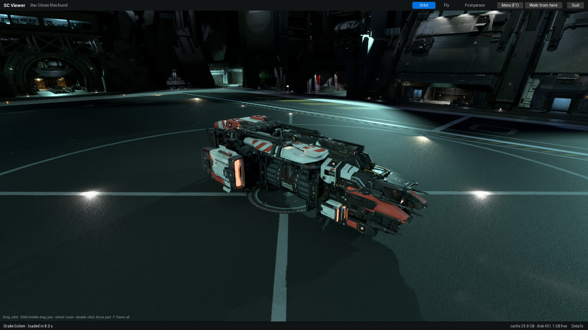
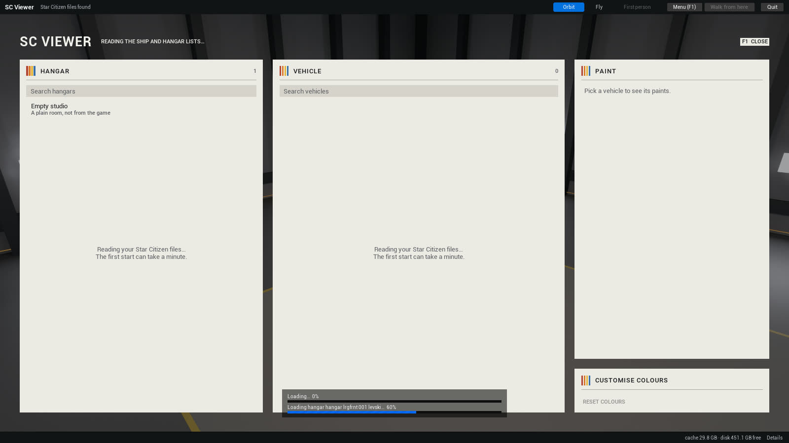
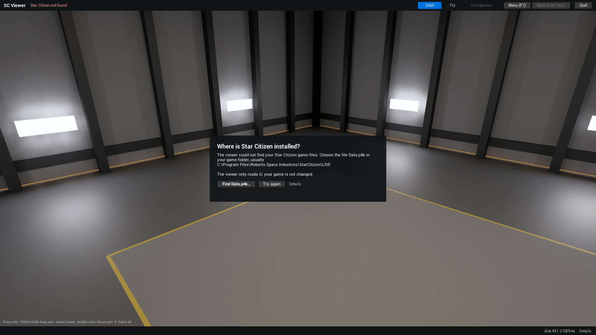
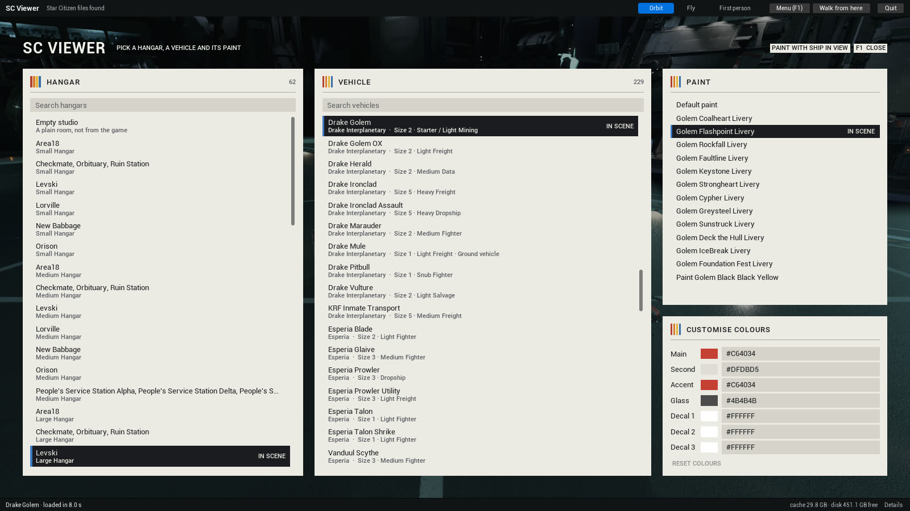
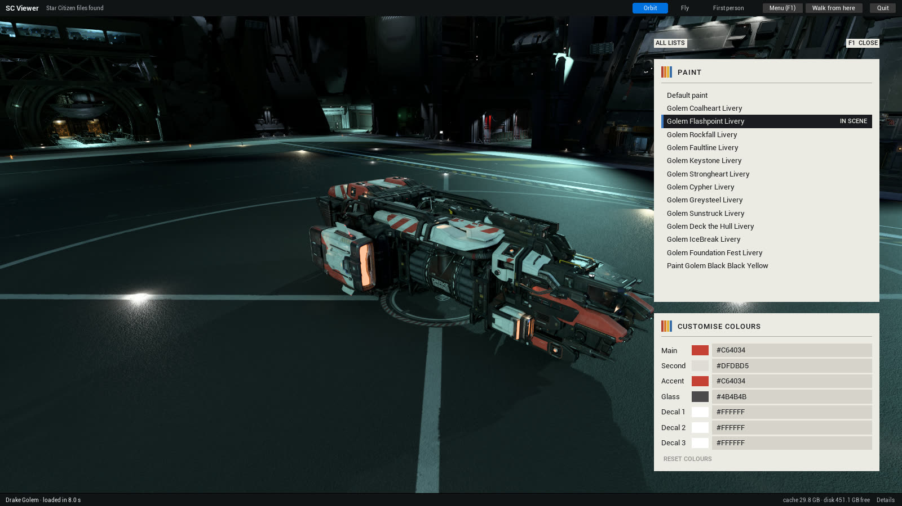
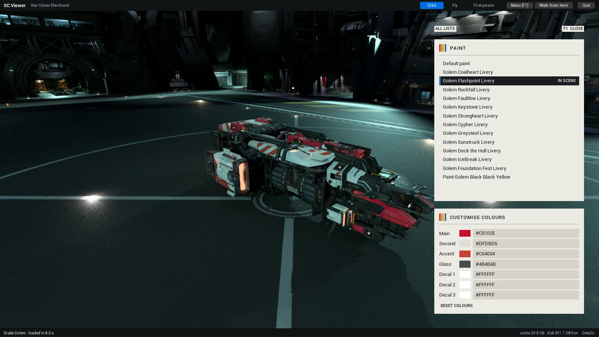
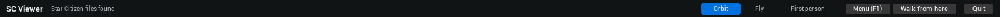
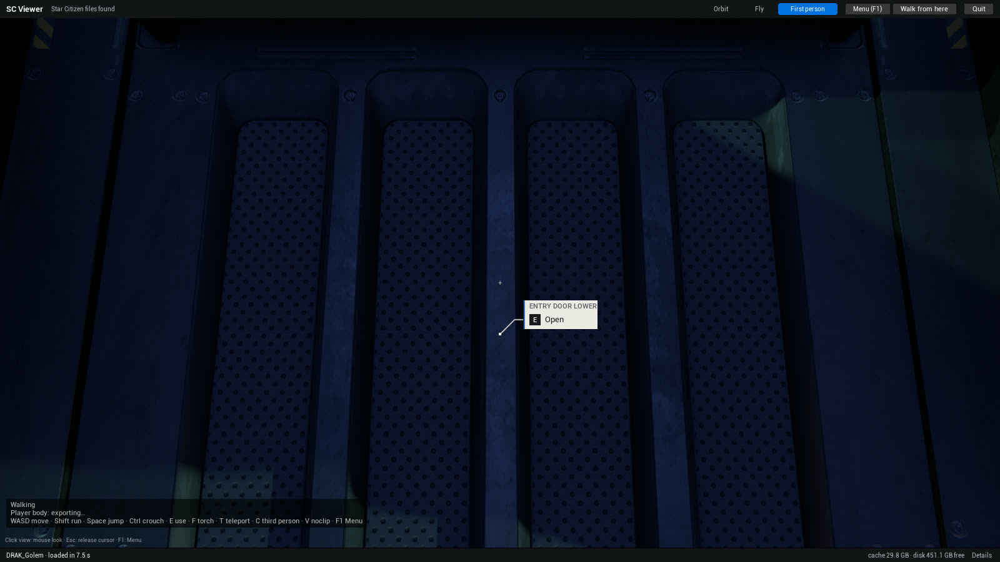

# SC Viewer — user guide

**SC Viewer** shows any ship from your own Star Citizen installation, in any of the game's hangars, in any of its
paints. You can recolour any paint and walk around and inside the ship. It is free, it runs on Windows, and it reads
everything from the game files already on your PC.



SC Viewer is a fan project. It is **not made or endorsed by Cloud Imperium Games**. It only *reads* the game's
`Data.p4k`. It never changes your game, never connects to the game's servers and never touches your account.

**Contents:**
1. [Requirements](#1-requirements)
2. [Download and start](#2-download-and-start)
3. [The first start](#3-the-first-start)
4. [Pick a hangar, a ship and a paint](#4-pick-a-hangar-a-ship-and-a-paint)
5. [Customise paint colours](#5-customise-paint-colours)
6. [Moving around](#6-moving-around)
7. [Troubleshooting](#7-troubleshooting)
8. [Questions and answers](#8-questions-and-answers)

## 1. Requirements

| | Minimum | Recommended |
| --- | --- | --- |
| Windows | Windows 10 64-bit (version 22H2) | Windows 11 |
| Star Citizen | installed (LIVE; PTU and EPTU also work) | |
| Graphics card | DirectX 12 with **Shader Model 6.6**: NVIDIA GeForce GTX 1060 / GTX 16-series, AMD Radeon RX 5000 series, Intel Arc, or newer | a ray-tracing card: NVIDIA GeForce RTX 3060, AMD Radeon RX 6700 XT, Intel Arc A750 or better, 8 GB of video memory |
| Memory (RAM) | 16 GB | 32 GB |
| Disk | 2 GB for the viewer, plus 10 GB for its cache | an SSD, 40 GB free (the most the cache grows to) |
| Graphics driver | a driver from the last 12 months | the newest driver |

**Ray tracing is optional.** On a graphics card without hardware ray tracing (GeForce GTX, Radeon RX 5000), the viewer
switches to simpler lighting by itself. The top bar then shows **Basic lighting**: fewer lights cast shadows and
reflections are simpler, and everything else works the same. The viewer was tested on an RTX card, with and without its
ray tracing.

A card without Shader Model 6.6 (older than the cards above) cannot run the viewer: it shows an error about DirectX 12
at start and closes.

## 2. Download and start

1. Open the [latest release](https://github.com/baadc0de/UnrealCitizen/releases/latest) and download
   `SCViewer-<version>-win64.zip` under **Assets** (about 0.5 GB).
2. Unzip it into a folder you can write to, for example `C:\Games` or `D:\Games`. This makes a folder `SCViewer`.
   Do not unzip it into `C:\Program Files`: the viewer keeps its cache next to itself and cannot write there.
3. Open the `SCViewer` folder and double-click **`SCViewer.exe`**.

Windows may warn "Windows protected your PC", because the viewer is not signed by a company. Click **More info**, then
**Run anyway**.

If Windows says that `VCRUNTIME140.dll` or `MSVCP140.dll` is missing, run
`SCViewer\Engine\Extras\Redist\en-us\vc_redist.x64.exe` once (the Microsoft Visual C++ runtime), then start the viewer
again.

There is no installer. To remove the viewer, delete the `SCViewer` folder and `%LOCALAPPDATA%\SCViewer` (its settings
and logs).

## 3. The first start

The viewer finds Star Citizen in its usual place,
`C:\Program Files\Roberts Space Industries\StarCitizen\LIVE`, by itself. It then reads the list of ships and hangars from
the game. **The first start takes a minute or two**; later starts reuse what it read and are quick.



**If Star Citizen is installed somewhere else**, the viewer asks where:



Click **Find Data.p4k…** and choose the file `Data.p4k` in your game folder. It is in the `LIVE` folder of your RSI
library, for example `D:\RSI\StarCitizen\LIVE\Data.p4k`. In the RSI Launcher, **Settings → Games → Library folder**
shows where your library is. The viewer remembers your choice. **Try again** looks in the usual place once more;
**Details** shows the exact error.

## 4. Pick a hangar, a ship and a paint

The menu opens by itself at start. Open it any time with **F1** or **Menu (F1)** in the top bar.



- **Hangar** (left): every player hangar in the game, by the places that offer it and its size; hangars in the game's
  files that no place offers come last, marked *Not offered at a location*. **Empty studio** is a plain room that is not
  from the game.
- **Vehicle** (middle): every ship and ground vehicle a player can own, by manufacturer, with size and role. Type in
  **Search vehicles** to find one: `cutlass`, `drake`, `fighter`.
- **Paint** (right): the ship's paints. **Default paint** is the one it comes with.

Click a row and it loads; you do not need to confirm. The row in the scene is black with **IN SCENE**; one on its way
says **LOADING**. A ship loads in about 5–30 seconds the first time (big ships take longer) and in a few seconds after
that. A bar at the bottom of the screen shows how far it has got. You can pick the next row while one loads; it follows.

Close the menu with **F1**, **Esc** or **F1 CLOSE** to look at the ship.

## 5. Customise paint colours

Every paint has up to seven colours you can change:

| Colour | What it is |
| --- | --- |
| Main, Second, Accent | the paint's three hull colours |
| Glass | the tint of the canopy and windows |
| Decal 1, 2, 3 | the colours of logos, stripes and markings |

To change them while you see the ship, open the menu (**F1**) and click **PAINT WITH SHIP IN VIEW** at the top right.
Only the paint and colour lists stay on screen, and you can still turn the ship with the mouse.



- **Click a colour swatch** to open a colour picker. The ship changes when you let go of the mouse.
- Or **type a colour code** such as `#C8102E` into the box next to it and press **Enter**. The code is the usual
  web colour: `#` and six hex digits for red, green and blue.
- **RESET COLOURS** puts the paint's own colours back.



Your colours are saved for each ship and paint and come back the next time you pick that paint. They are in
`%LOCALAPPDATA%\SCViewer\Saved\PaintColors.json`. You can also edit that file by hand while the viewer is closed:

```json
{
  "version": 1,
  "paints": [
    {
      "vehicle": "DRAK_Golem",
      "palette": "<written by the viewer; keep it as it is>",
      "paint": "Golem Flashpoint Livery",
      "colors": { "primary": "#C8102E", "secondary": "#DFDBD5" }
    }
  ]
}
```

The colour names in the file are `primary` (Main), `secondary` (Second), `tertiary` (Accent), `glass`, `decal_red`,
`decal_green` and `decal_blue` (Decal 1–3). The easiest way to make an entry is to change one colour in the viewer, then
edit the file. Colours only exist in the viewer; the game never sees them.

**ALL LISTS** goes back to the full menu.

## 6. Moving around

The top bar switches between three ways of looking:



**Orbit** (the start): the camera circles the ship.

| Input | Does |
| --- | --- |
| drag with the left mouse button | turn around the ship |
| Shift + drag, or drag with the middle button | move sideways |
| mouse wheel | closer / farther |
| double-click a part | centre on that part |
| F | show the whole ship |

**Fly**: a free camera, for looking around the hangar.

| Input | Does |
| --- | --- |
| drag | look around |
| W A S D | move |
| E / Q | up / down |
| Shift / Ctrl (hold) | faster / slower |
| mouse wheel | flying speed |

**First person**: walk around and into the ship as a player. It is available once a ship has loaded. **Walk from
here** starts you at the spot on the ship you look at in Orbit or Fly.



| Input | Does |
| --- | --- |
| click the view | mouse look (Esc lets the cursor go) |
| W A S D, Shift, Space, Ctrl | walk, run, jump, crouch |
| E | use what you look at (doors, lifts, seats, ladders); the mouse wheel picks an option when there are several |
| F | torch |
| T | teleport menu: the ship's entrances, seats and the hangar |
| C | third person; Z circles the camera around you |
| V | noclip: pass through walls (if you are stuck) |
| 1–9, H | draw a weapon, holster it |
| left / right mouse button | fire / aim (with a weapon drawn) |

**Quit** at the top right closes the viewer.

## 7. Troubleshooting

**"Basic lighting" in the top bar.** Your graphics card or its driver has no hardware ray tracing; see
[Requirements](#1-requirements). Updating the graphics driver sometimes turns it on.

**The viewer is slow.** Close other programs that use the graphics card. If you have a ray-tracing card but a slow one,
start the viewer without ray tracing: make a shortcut to `SCViewer.exe` and add ` -noraytracing` after the path in the
shortcut's **Target**.

**A ship fails to load** (a red line at the bottom). Pick it again. If it fails again, the game patch may have changed
that ship in a way the viewer does not know yet. Report it (see below) with the ship's name.

**After a Star Citizen patch.** The viewer reads the new files by itself; the first start after a patch takes longer
again. If something looks wrong, quit the viewer and delete the `cache` folder inside the `SCViewer` folder.

**The cache.** The viewer keeps what it read from the game in `SCViewer\cache`, up to about 40 GB. It is safe to delete
any time the viewer is closed; it is made again when needed.

**The viewer does not start, or closes.** Update your graphics driver. Check the
[requirements](#1-requirements). The log is `%LOCALAPPDATA%\SCViewer\Saved\Logs\SCViewer.log`; attach it when you report
a problem.

**Wrong game version.** If you have LIVE and PTU, the viewer opens the one updated last. To choose one, make a shortcut
to `SCViewer.exe` and add the game folder's `Data.p4k` after the path in the shortcut's **Target**, for example
` -SCArchive="D:\RSI\StarCitizen\PTU\Data.p4k"`. The viewer opens that one from then on, also without the shortcut;
point it back with another `-SCArchive=`.

## 8. Questions and answers

**Is it safe for my account?** The viewer does not start, change or connect to Star Citizen. It reads `Data.p4k` the
way a file viewer reads a file.

**Can I share screenshots?** Take them with any screenshot tool (Windows: **Win + Shift + S**). The ships and hangars
are Cloud Imperium Games' work: follow their fan content rules when you share.

**Does it work with PTU?** Yes, see [Wrong game version](#7-troubleshooting).

**Where do I report a bug or ask for a feature?** Open an issue at
[github.com/baadc0de/UnrealCitizen/issues](https://github.com/baadc0de/UnrealCitizen/issues). Say which ship, hangar
and paint, what you expected and what happened, and attach the log.

**Licence.** The viewer is MIT-licensed (`LICENSE.txt` in the download). It reads the game's formats with
[StarBreaker](https://github.com/diogotr7/StarBreaker) (MIT) and is built with Unreal Engine 5 (Unreal® Engine,
Copyright Epic Games, Inc.). Star Citizen®, its ships and its art are © Cloud Imperium Rights LLC and Cloud Imperium
Rights Ltd.
